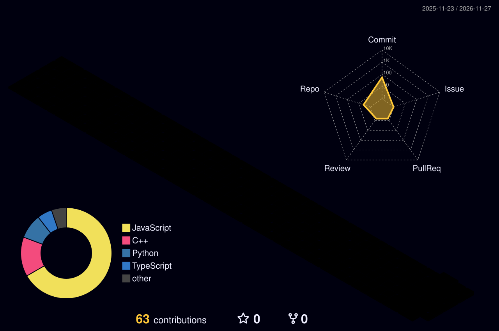

<div align="center">

  <!-- Animated Header Banner -->
  

  <!-- Animated Typewriter -->
  <a href="https://github.com/Daniyal-ali-code">
    
  </a>

  <p align="center">
    
    
    
  </p>

</div>

---

### 👨‍💻 About Me

```yaml
name: Daniyal-ali-code
role: Full-Stack Engineer & Open-Source Builder
location: Global
bio: Building high-performance software and open-source tooling.
```

---

### 🛠️ Tech Stack & Ecosystem

<div align="center">
  
</div>

---

### 📊 Real-Time GitHub Analytics

<div align="center">
  <table border="0">
    <tr>
      <td>
        <a href="https://github.com/Daniyal-ali-code">
          
        </a>
      </td>
      <td>
        <a href="https://github.com/Daniyal-ali-code">
          
        </a>
      </td>
    </tr>
  </table>
</div>

---

### 🐍 Contribution Activity Snake

<div align="center">
  <picture>
    <source media="(prefers-color-scheme: dark)" srcset="https://raw.githubusercontent.com/Daniyal-ali-code/Daniyal-ali-code/main/assets/github-contribution-grid-snake-dark.svg?v=2" />
    <source media="(prefers-color-scheme: light)" srcset="https://raw.githubusercontent.com/Daniyal-ali-code/Daniyal-ali-code/main/assets/github-contribution-grid-snake.svg?v=2" />
    
  </picture>
</div>

<div align="center">
  <details>
    <summary><strong>🧊 Click to Expand 3D Isometric Contribution Graph</strong></summary>
    <br/>
    
  </details>
</div>

---

<div align="center">
  
</div>
